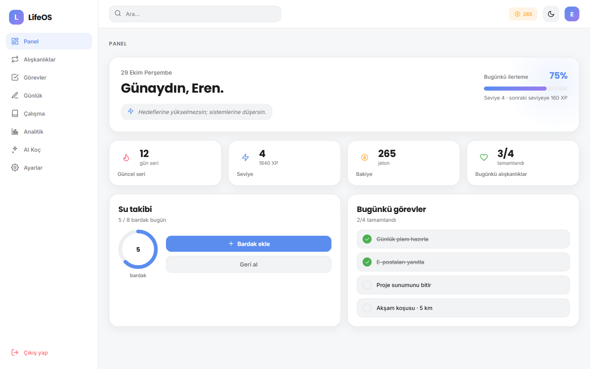
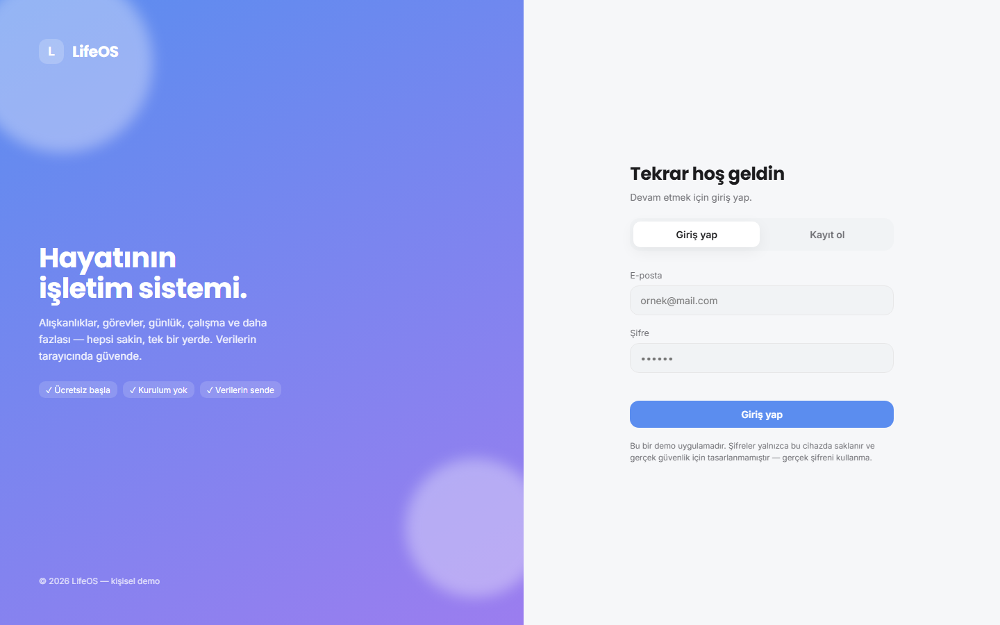

# LifeOS — Kişisel Yaşam İşletim Sistemi

**Alışkanlıklar, görevler, günlük, çalışma ve analitik tek bir yerde.**

**[▶ Canlı demo](https://owxmaybe.github.io/lifeos/)**

LifeOS, günlük hayatını tek bir panelden yönetmen için tasarlanmış, tamamen tarayıcıda çalışan bir
üretkenlik uygulamasıdır. Kurulum, sunucu veya hesap servisi gerektirmez. Tüm veriler cihazında
(`localStorage`) kalır ve hiçbir yere gönderilmez.



<details><summary>Giriş ekranı</summary>



</details>

## Modüller

| Modül | Ne yapar |
|---|---|
| **Panel** | Kişiye özel karşılama, günün özeti, ilerleme göstergeleri |
| **Görevler** | Görev ekleme, önceliklendirme, tamamlama |
| **Alışkanlıklar** | Günlük alışkanlık takibi ve seriler (ör. *Su iç*, *Meditasyon*, *20 sayfa oku*) |
| **Günlük** | Günlük yazma ve kayıt arşivi |
| **Çalışma** | Odaklı çalışma oturumları ve süre takibi |
| **Analitik** | Tamamlanan alışkanlık ve görevlerin grafikleri *(Premium)* |
| **AI Koç** | Verilerine göre öneri sunan koç sohbeti ve günlük plan hazırlama *(Premium)* |
| **Ayarlar** | Profil, tema ve veri yönetimi |

## Özellikler

- **Tek dosya:** Tüm uygulama `index.html` içinde. Harici framework yok, saf HTML, CSS ve JavaScript.
- **Yerel hesaplar:** Kayıt ve giriş ekranı var, birden çok kullanıcı profili desteklenir. Veriler tarayıcıda saklanır.
- **Gizlilik öncelikli:** Ağa veri gönderilmez, yalnızca yazı tipleri Google Fonts'tan yüklenir.
- **Premium akışı (demo):** Ücretli özelliklerin kilitlenmesi ve açılması simüle edilir. Gerçek ödeme alınmaz.
- **Duyarlı tasarım:** Masaüstünde ve mobilde çalışır.

## Çalıştırma

`index.html` dosyasını herhangi bir modern tarayıcıda açman yeterli. Yerel sunucu ile çalıştırmak için:

```bash
python -m http.server 8000
```

## Teknolojiler

`HTML5` · `CSS3` · `Vanilla JavaScript` · `localStorage`

---

**Geliştirici:** Eren Tyto ([@OwXMaybe](https://github.com/OwXMaybe)) · [MIT Lisansı](LICENSE)
